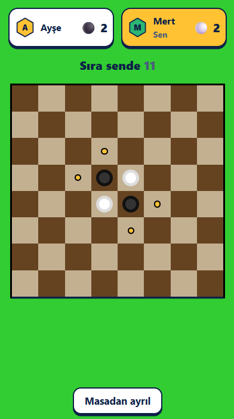
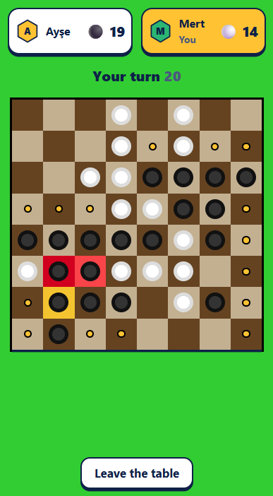
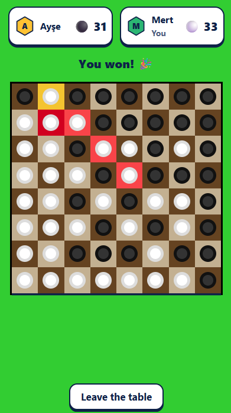

# Reversi

Made with [Kampuse Games Kit](https://kampuse.com/games-kit)

**Player Count:** 2  
**Seconds per turn:** 30

### Description 
The game starts with 2 pieces on the board per player at the center that are placed diagonally.
Each turn you must play a move that captures at least one opponent piece. To capture, place a piece on the board where there is at least one opponent piece between the piece you placed and an existing piece you own. You can capture in 8 directions. Captured pieces are converted to your color. If you have no moves available, your turn is skipped. If both players have no available moves, the game is over. The player with the most pieces wins. If the players have an equal amount of pieces, the game ends in a draw.

### Screenshots

    

    

    

